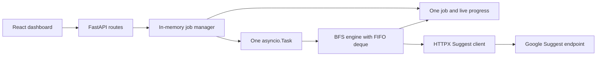

# Architecture



The React dashboard creates one job and polls status/results through the implemented research API routes. The implemented manager owns one job and one background `asyncio.Task`. The BFS engine runs in the same process, consumes its bounded FIFO `deque`, makes paced Suggest requests, records discoveries, and queues eligible next queries. Python sets track normalized queued/processed queries and unique keywords; dictionaries/lists hold job details, discovery origins, progress, and errors. The manager uses an `asyncio.Lock` for lifecycle transitions and exposes the live result without copying its keyword collection.

Run exactly one backend process and one research worker task. Multiple Uvicorn workers or replicas would each have separate memory and cannot serve a coherent job. `uvicorn --reload` restarts the process after code changes and clears research state. A browser refresh can recover the current job from the running backend, but a backend restart cannot. The dashboard warns users to export before stopping the backend. No database, file based job store, or restart recovery is planned.

## Job flow and state

1. `POST /api/research` validates configuration with Pydantic and calls the manager. The manager rejects any new job while one exists, including a finished job, until the caller explicitly clears it. This protects unexported results.
2. Enqueue initial queries in deterministic breadth first order. Each queue item records query text, target suggestion depth, parent, and method. A set prevents duplicate query requests.
3. The worker awaits pause/resume signals between requests, checks cancellation and request budget, calls HTTPX, records unique suggestions plus origins, and enqueues eligible recursive work. It updates progress in memory after each attempt.
4. When the queue is drained, a safety limit is reached, or cancellation is requested, the manager marks a terminal status and retains results until explicitly cleared or the process exits. Unexpected exceptions mark `FAILED`; an abrupt process exit loses the job.
5. CSV export captures scalar rows from current results in one synchronous pass, then streams them. This gives a consistent partial export while the worker continues. Each discovery origin gets a row. Untrusted text is guarded against spreadsheet formulas.

## Planned structure

```text
backend/app/api/routes/      # HTTP endpoints
backend/app/core/            # environment configuration
backend/app/services/        # Suggest client, one-pass expansion, recursive BFS
backend/app/research/        # in-memory job manager and background task
backend/scripts/             # optional manual single-query check
backend/tests/               # unit and API tests
frontend/src/                # React views and components
docs/                        # specifications and task plan
```

T1.1 provides the FastAPI app and health route; T1.2 provides the frontend foundation. T2.1 adds the asynchronous Suggest client, and T3.1 adds one-pass expansion. T3.4 adds `backend/app/services/recursive_research.py`: a sequential FIFO traversal that records depth and discovery edges in memory. The Suggest client accepts an optional attempt cap and callback so retries count against the research budget. T4.1 adds `backend/app/research/job_manager.py` for one background job, lifecycle controls, and live progress. T5.1 adds the validated research API, paginated keyword results, and formula-safe CSV export. One manager instance belongs to each FastAPI process. No public CORS middleware is enabled.

The BFS engine enqueues unique queries at depth 1, processes the oldest query, stores returned suggestions with parent/query/method/depth, and enqueues eligible suggestions at the next depth. It stops expanding at `max_depth` (1–4). The queue and keyword limits bound memory, while the attempt budget bounds HTTP activity. A full queue truncates new work and records that fact. The manager's resume event gates new HTTP attempts; its cancellation event stops future attempts and releases a paused task. The job and result are never persisted. A single backend process is required; a restart loses all state.


## Dashboard

The React dashboard uses relative /api requests through the Vite development proxy. It checks backend health, restores the current job on load, polls active progress and keyword pages every two seconds, and stops polling terminal jobs. The form validates backend-supported defaults and limits before POST /api/research. Keyword search and pagination run on the backend; sorting applies to the visible page. CSV export downloads the backend-generated file, and clear requires confirmation. No results are stored in browser storage. Country and language selectors are independent. No public CORS is enabled.
